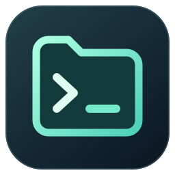

<p align="center">
  
</p>

# SSH Studio

[](LICENSE)
[](https://tauri.app/)

**Một workspace cho terminal SSH, file SFTP và SSH key của nhiều server.**

Ứng dụng desktop Windows quản lý SSH terminal, file SFTP và SSH key. Backend **Rust + Tauri 2**, giao diện **React + xterm.js**. Không có Electron hoặc Node backend trong ứng dụng đóng gói.

## Chạy ứng dụng

Yêu cầu Node.js 20.19+ / 22.12+, Rust 1.91.1+ với toolchain MSVC, Visual Studio C++ Build Tools và WebView2 trên Windows.

```powershell
git clone https://github.com/rickymta/ssh-studio.git
cd ssh-studio
npm ci
npm start
```

`npm run dev` chỉ mở frontend Vite, không có khả năng kết nối SSH. Dùng `npm start` để chạy cửa sổ Tauri và backend Rust.

## Tính năng

**Server & kết nối**
- Thêm, sửa, xóa server; tìm theo tên/IP/username (Ctrl+K); phân nhóm theo môi trường hoặc dự án.
- Workspace: gom server theo khách hàng / dự án (tên, màu); đổi workspace ở góc trên sidebar, server và nhóm hiển thị theo workspace đang chọn. Xóa workspace sẽ chuyển server sang workspace khác; sao lưu / khôi phục giữ nguyên workspace (gộp theo tên).
- Xác thực bằng password, private key, SSH agent (Windows OpenSSH agent / Pageant, `SSH_AUTH_SOCK` trên Unix) hoặc keyboard-interactive / MFA (OTP), kể cả chuỗi nhiều bước (key rồi OTP). Password được hỏi khi kết nối, hoặc lưu mã hóa trong vault nếu bạn chọn “Lưu mật khẩu”; mã OTP không bao giờ được lưu.
- Jump host (ProxyJump, cho phép chuỗi nhiều bước, chặn vòng lặp) và proxy SOCKS5 / HTTP CONNECT. Mật khẩu proxy nằm trong vault mã hóa.
- Port forwarding Local (-L), Remote (-R) và Dynamic SOCKS5 (-D) trong tab **Ports** của phiên; forward đã lưu tự bật khi kết nối.

**Terminal**
- Nhiều phiên SSH cùng lúc, kể cả nhiều phiên tới cùng server; kết nối lại giữ nguyên tab và scrollback.
- PTY `xterm-256color`, màu ANSI, resize, mouse report; Ctrl+Shift+C/V, Ctrl/Shift+Insert và chuột phải để sao chép / dán, tùy chọn copy-on-select.
- Tìm trong terminal (Ctrl+Shift+F) có tô sáng kết quả, phân biệt hoa thường, regex.
- Phím tắt: Ctrl+Tab, Ctrl+1..9, Ctrl+Shift+W, Ctrl+Shift+T (mở lại server vừa đóng), Ctrl+= / Ctrl+- / Ctrl+0, F1 / Ctrl+/ (bảng phím tắt), Ctrl+Shift+L (nhật ký). Không chiếm Ctrl+C/V/W của shell; F1–F12, Ctrl+R… không còn tải lại cửa sổ như trình duyệt.

**File (SFTP)**
- Hai khung local/remote, chế độ Terminal / Files / Chia đôi (terminal trên, file dưới) / Song song (terminal trái, file phải). Kéo thanh chia để đổi kích thước terminal, hai khung file và các cột Tên / Kích thước (nhấp đúp để đặt lại; lưu trên máy). Chọn nhiều mục (Ctrl/Shift-click, Ctrl+A), kéo thả giữa hai khung và từ Explorer vào khung remote.
- Upload/download file và thư mục đệ quy, tiến độ gộp, hàng đợi hai tác vụ song song, hủy, thử lại / tiếp tục từ chỗ dừng (resume), giữ thời gian sửa đổi.
- Trùng tên thì hỏi: Ghi đè / Giữ cả hai / Bỏ qua / Hủy, có "áp dụng cho tất cả". Không bao giờ tự ghi đè.
- Sửa file text remote (≤ 5 MB, UTF-8) với số dòng, Ctrl+S, giữ kiểu xuống dòng và quyền file, báo xung đột khi file bị đổi trên server.
- Xóa thư mục không rỗng (xác nhận số mục), đổi quyền (chmod), mở symlink tới thư mục.
- Đồng bộ thư mục: so sánh local ↔ remote, xem trước, chọn chiều và từng mục; chế độ mirror (xóa phía đích) phải xác nhận riêng.

**SSH key & dữ liệu**
- Nhập private key OpenSSH / PEM / PuTTY `.ppk` (v2, v3, có hoặc không passphrase); tạo key Ed25519; sao chép public key; dùng chung key cho nhiều server.
- Xuất private key ra file OpenSSH, tùy chọn passphrase.
- Sao lưu toàn bộ workspace (server, key, mật khẩu đã lưu, mật khẩu proxy, known hosts) vào file `.sshstudio-backup` mã hóa bằng mật khẩu riêng; khôi phục có xem trước và gộp không phá dữ liệu.
- Xác nhận SHA256 fingerprint lần đầu; Known Hosts; chặn khi host key thay đổi.

**Ứng dụng**
- Trang **Cài đặt**: font, cỡ chữ, giãn dòng, scrollback, con trỏ, chế độ xem mặc định, xác nhận khi đóng, thu về khay, cỡ giao diện (80–150%).
- **Trợ giúp** (F1 hoặc nút ở thanh trạng thái): bảng phím tắt có ô lọc, hướng dẫn nhanh, giới thiệu (phiên bản, hệ điều hành, thư mục dữ liệu).
- **Nhật ký hoạt động** (Ctrl+Shift+L): kết nối, truyền file và thông báo của ứng dụng, lọc theo lỗi và tìm kiếm; lưu 30 ngày / 1000 dòng trên máy, không chứa mật khẩu hay mã OTP.
- Biểu tượng khay hệ thống: hiện cửa sổ, số phiên đang kết nối, thoát; tùy chọn chạy nền khi đóng cửa sổ.
- `workspace.json` hỏng không làm app dừng: file được giữ lại để khôi phục, app mở với workspace trống.

## Sử dụng

1. Nếu dùng key: vào **SSH Keys**, nhập private key hoặc tạo mới. Với key tạo mới, sao chép public key và thêm vào `~/.ssh/authorized_keys` trên server qua kênh quản trị tin cậy.
2. Chọn **Thêm server**, điền hostname/IP, port, username và phương thức xác thực. Ở **Kết nối qua**, chọn Trực tiếp, một jump host đã lưu, hoặc proxy.
3. Chọn **Kết nối**. Đối chiếu fingerprint với console server hoặc quản trị viên trước khi tin cậy. Password / OTP được hỏi trong hộp thoại; tick “Lưu mật khẩu” để lần sau không phải nhập lại (xóa trong **Chỉnh sửa server**).
4. Mở thêm kết nối từ danh sách Servers; chuyển tab bằng chuột hoặc Ctrl+Tab / Ctrl+1..9.
5. Trong **Files**, chọn thư mục ở cả hai khung, chọn file / thư mục rồi **Upload** / **Download**, hoặc kéo thả. Nhấp đúp file text remote để sửa; **Đồng bộ** để so sánh hai thư mục.
6. Trong **Ports**, thêm forward; đánh dấu "Lưu vào server" để tự bật ở lần kết nối sau.
7. Ở **SSH Keys**, **Sao lưu** tạo file backup có mật khẩu; **Khôi phục** gộp backup vào máy khác.

## Dữ liệu và bảo vệ key

Tauri lưu `workspace.json` trong thư mục AppData của `dev.sshstudio.desktop` (Windows thường là `%APPDATA%\dev.sshstudio.desktop`). Metadata server, public key và cài đặt không phải bí mật. Private key, mật khẩu đăng nhập đã lưu và mật khẩu proxy được mã hóa bằng AES-256-GCM với nonce ngẫu nhiên; master key được lưu trong Windows Credential Manager, service `dev.sshstudio.desktop`, entry `vault-master-key`. Các bí mật này không được trả về frontend, không xuất hiện trong event hay log.

Key có passphrase được mở khóa lúc nhập, sau đó bản private key trong vault được bảo vệ bởi mã hóa của ứng dụng. Sao chép riêng `workspace.json` sang máy khác không chuyển được khả năng giải mã. Để chuyển máy, dùng **Sao lưu / Khôi phục**: file backup được mã hóa AES-256-GCM bằng khóa dẫn xuất từ mật khẩu của bạn (Argon2id), không phụ thuộc Credential Manager. Quên mật khẩu backup thì không mở được file. Private key chỉ rời vault khi bạn chủ động xuất hoặc sao lưu. Không có đồng bộ cloud hoặc telemetry.

## Giới hạn

- Bản build chưa ký số. Cấu hình ký đã chuẩn bị sẵn (`npm run dist:signed`), cần chứng chỉ của chủ dự án — xem [docs/RELEASE.md](docs/RELEASE.md).
- Windows là nền tảng đã kiểm tra. Code giữ đa nền tảng (Keychain / Secret Service, agent qua `SSH_AUTH_SOCK`), nhưng chưa build và chạy thử trên macOS/Linux.
- SFTP v3 không có rename ghi đè: ghi đè file remote đổi tên file cũ sang `.<tên>.sshstudio-old-…` rồi đưa file mới vào. Nếu mất kết nối đúng lúc đó, file cũ còn lại dưới tên tạm này.
- Đồng bộ so sánh theo kích thước và thời gian sửa đổi (sai lệch ≤ 2 giây coi là bằng nhau), không so nội dung; symlink được bỏ qua.
- Trình sửa file không tô màu cú pháp; chỉ mở file UTF-8 tối đa 5 MB.
- Dynamic forward là SOCKS5 không xác thực, chỉ lệnh CONNECT. Link trong terminal chưa bấm được.

## Kiểm tra và build

```powershell
npm run build
npm test
npm run pack
npm run dist
```

- `npm test`: Rust unit tests và server SSH/SFTP loopback tự tạo, không sử dụng server hay credential thật.
- `npm run pack`: executable release tại `src-tauri/target/release/ssh-studio.exe`.
- `npm run dist`: thêm NSIS installer tại `src-tauri/target/release/bundle/nsis/`.
- `npm run dist:signed`: như `dist` nhưng ký số executable và installer (cần chứng chỉ, xem [docs/RELEASE.md](docs/RELEASE.md)).

Test chạy trên server SSH/SFTP giả lập trong tiến trình, dùng thư mục tạm thật làm ổ đĩa remote: vault và backup (sai mật khẩu, file bị sửa), không lộ secret trong snapshot, nhập PPK, truyền thư mục, xung đột ghi đè / bỏ qua / giữ cả hai, resume sau khi ngắt, sửa file và phát hiện xung đột, đồng bộ, MFA nhiều bước, keyboard-interactive, SSH agent, jump host, proxy SOCKS5 / HTTP, port forwarding -L / -R / -D, host key thay đổi. Phần giao diện có test vitest cho các hàm thuần (chọn nhiều, kế hoạch xung đột, đồng bộ, phím tắt…).

## Cấu trúc

- `src/main.jsx`: khung ứng dụng, trang Servers / SSH Keys / Known Hosts, sự kiện backend, phím tắt.
- `src/components/`: terminal, file manager, transfer, editor, đồng bộ, port forwarding, sao lưu, cài đặt và các hộp thoại.
- `src/lib.js`: hàm thuần dùng chung (có test trong `src/lib.test.js`).
- `src/style.css`: giao diện desktop tối.
- `src-tauri/src/main.rs`: Tauri commands và state dùng chung.
- `src-tauri/src/ssh.rs`: host verification, xác thực (password, key, agent, keyboard-interactive), jump host, vòng đời phiên.
- `src-tauri/src/proxy.rs`, `forward.rs`: proxy SOCKS5 / HTTP và port forwarding.
- `src-tauri/src/files.rs`, `transfer.rs`, `edit.rs`, `sync.rs`: SFTP, hàng đợi truyền, sửa file, đồng bộ.
- `src-tauri/src/store.rs`, `backup.rs`: metadata, cài đặt, vault mã hóa, xuất key và sao lưu.
- `src-tauri/src/tray.rs`: khay hệ thống.
- `src-tauri/src/integration/`: server fixture và integration test.

Backend dùng [russh](https://github.com/warp-tech/russh), [russh-sftp](https://docs.rs/russh-sftp/latest/russh_sftp/) và [keyring](https://docs.rs/keyring/latest/keyring/). Quyền frontend được khai báo trong `src-tauri/capabilities/default.json`; CSP giới hạn kết nối của webview vào IPC Tauri.

## Bộ icon

Icon chính kết hợp thư mục và dấu lệnh `>_`, nền xanh đậm và nét mint. Icon status bar là bản đơn sắc trắng, nền trong suốt.

| Icon | Nguồn | File xuất |
| --- | --- | --- |
| Ứng dụng | [logo.svg](assets/logo.svg) | [PNG 1024 px](assets/exports/app/1024x1024.png), [Windows ICO](src-tauri/icons/icon.ico) |
| Status bar | [statusbar.svg](assets/statusbar.svg) | [PNG 16–48 px](assets/exports/statusbar/) |

Icon đã được tích hợp vào sidebar, status bar, khay hệ thống và bộ icon đóng gói của Tauri. Xem [hướng dẫn tái tạo icon](assets/ICONS.md).

## Đóng góp

Đọc [CONTRIBUTING.md](CONTRIBUTING.md) để thiết lập môi trường, chạy kiểm tra và gửi pull request. Báo lỗi hoặc đề xuất tính năng tại [GitHub Issues](https://github.com/rickymta/ssh-studio/issues). Không đưa credential, private key hoặc dữ liệu server thật vào issue, log hay ảnh chụp màn hình.

## Giấy phép

Mã nguồn và bộ icon của dự án được phát hành theo [MIT License](LICENSE). Các thư viện phụ thuộc giữ giấy phép riêng của chúng.
